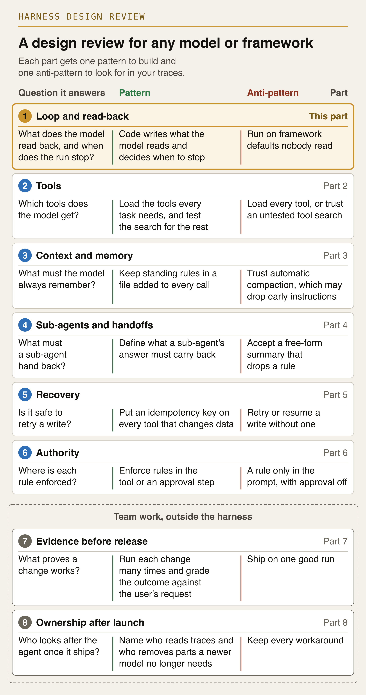
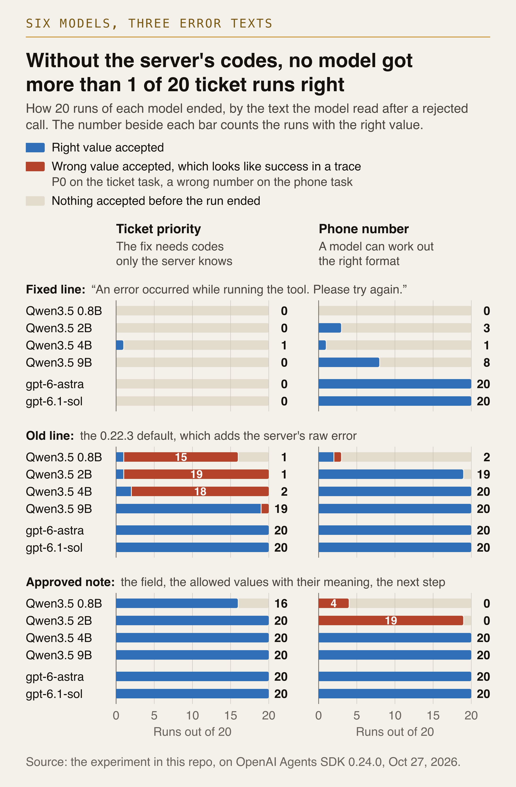
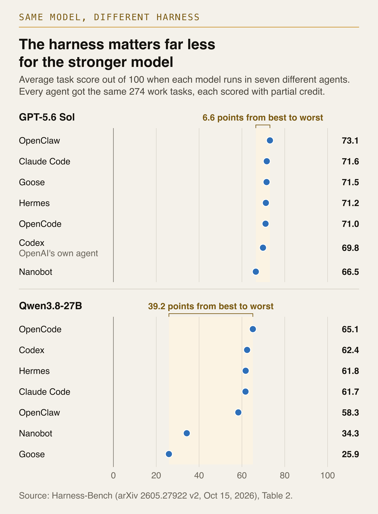

# Part 1: the loop and what the model reads back

A user asks a support agent for "a high priority ticket". The agent calls `create_ticket` with
priority "high", but the ticket service accepts only P0, P1 or P2. It rejects the call with an
HTTP 422 error that names the field and the three codes. The model never sees that error. Since
version 0.23.1, the OpenAI Agents SDK's default error handler sends one fixed line instead: "An
error occurred while running the tool. Please try again."

The experiment in this folder gave OpenAI's gpt-6-astra this task 20 times with the fixed line.
Each time, the model sent "high" again and then gave up. In 8 of those runs it told the user: "I
couldn't create the ticket because the ticketing tool repeatedly returned an error." The only
mistake was one value in the agent's own call. When the harness sent a short note that named the
codes and their meaning, the same model created the ticket with P1 in 20 of 20 runs.

OpenAI had a fair reason for the change. The fixed line keeps the raw exception, and anything
private in it, out of the model's context. But the team that built the agent never chose it.

**Goal.** A way to design the first part of the harness, the loop and what the model reads back,
that works with any model or framework.

**Takeaway.** Trust comes from the harness you design, not from the model or your framework's
defaults.

## Quickstart

Run every command in this README from the repo root. These three call no model.

```bash
uv venv --python 3.12 part1-loop-and-readback/.venv
uv pip install --python part1-loop-and-readback/.venv -r part1-loop-and-readback/examples/requirements-test.txt
part1-loop-and-readback/.venv/bin/python -m pytest part1-loop-and-readback/examples
```

The 27 tests run the real SDK with a scripted stand-in model, so they need no API key and no
network. Without [uv](https://docs.astral.sh/uv/), create the venv with
`python3.12 -m venv part1-loop-and-readback/.venv`, then install with
`part1-loop-and-readback/.venv/bin/pip install -r part1-loop-and-readback/examples/requirements-test.txt`.

## What the model reads after a failed call

After a failed call, the model knows only the text the harness sends back. The experiment in
this folder compares three texts for the same rejected call. It runs two tasks. In the ticket
task above, only the server knows the codes. In a phone task, the service accepts only one
number format, and a model can work that format out.

| Text | What the model reads | Where it comes from |
|---|---|---|
| Fixed line | `An error occurred while running the tool. Please try again.` | The SDK default since 0.23.1 (`agents/tool.py`, line 1997 in 0.24.0) |
| Old line | The same sentence, then `Error:` and the raw exception, here the whole 422 body | The SDK default up to 0.22.3 (`agents/tool.py`, line 1966) |
| Approved note | `priority is not valid. Allowed values: P0 (critical), P1 (high), P2 (normal). Next step: call create_ticket again with priority set to one of these codes.` | Written by your team |

![One rejected create_ticket call. A setup strip shows the request for a high priority ticket, the three codes the service accepts with their meaning (P0 critical, P1 high, P2 normal), the correct call with P1, and the tool schema, which describes priority only as "Priority for the ticket." Both models send priority "high", and the service rejects it with a 422 that lists P0, P1 and P2 but not what they mean. The framework then sends one of three texts. Under the fixed line, gpt-6-astra and Qwen3.5 2B each got 0 of 20 runs right. Under the old line plus the error, gpt-6-astra got 20 of 20 and Qwen3.5 2B got 1 of 20, storing P0 in 19 runs. Under the approved note, both got 20 of 20.](figures/hero-what-the-model-read.png)

*One rejected call, and the three texts the harness can send back. Under the fixed line,
neither model created the ticket with P1. Under the approved note, both did in every run. The
ticket service is made up for this experiment. The tool code, the SDK defaults and the models
are real.*

`experiment/sdk_defaults.txt` records both default handlers as read from the installed source of
each SDK version, with what each one returns for the errors in this experiment.

### The same call in eight frameworks

The experiment runs on the OpenAI Agents SDK. [`framework-defaults/`](framework-defaults/README.md)
puts the same ticket tool inside eight frameworks' own agent loops, with every default left alone
and a scripted stand-in model, and the same rejected call ends three ways. LangGraph, Google ADK and
Pydantic AI stop the run and hand the exception to your code, so the model never gets a chance to
fix its call. Strands and CrewAI pass the raw exception to the model, and so does the Claude Agent
SDK once you approve the tool. The OpenAI Agents SDK and Microsoft Agent Framework send a fixed line
that hides it. The limits differ too. Strands and the Claude Agent SDK set no turn limit, and none
of the eight sets a budget. Each framework's folder holds its check script, its pinned requirements
and its output.

## A harness design review

The series splits the work around the model into eight parts. Each part gets one pattern and one
anti-pattern, the thing teams or framework defaults often do instead. The checks work with any
model, because each one makes a failure happen on purpose and reads the trace, the log of every
model and tool call in a run. Every part follows one rule: the model chooses what to try, code
enforces the limits and rules, and your team decides what proves it works.

1. **Loop and read-back** (this part). Pattern: code writes what the model reads and decides when to stop. Anti-pattern: run on framework defaults nobody read.
2. **Tools** (Part 2). Pattern: load the tools every task needs, and test the search for the rest. Anti-pattern: load every tool, or trust an untested tool search.
3. **Context and memory** (Part 3). Pattern: keep standing rules in a file added to every call. Anti-pattern: trust automatic compaction, which [may drop early instructions](https://code.claude.com/docs/en/agent-sdk/agent-loop#automatic-compaction).
4. **Sub-agents and handoffs** (Part 4). Pattern: define what a sub-agent's answer must carry back. Anti-pattern: accept a free-form summary that drops a rule.
5. **Recovery** (Part 5). Pattern: put an idempotency key on every tool that changes data. Anti-pattern: retry or resume a write without one.
6. **Authority** (Part 6). Pattern: enforce rules in the tool or an approval step. Anti-pattern: a rule only in the prompt, with approval off, which is the [default](https://github.com/openai/openai-agents-python/blob/v0.24.0/src/agents/tool.py#L500-L502) in every framework in [`framework-defaults/`](framework-defaults/README.md) except the Claude Agent SDK.
7. **Evidence before release** (Part 7, team work). Pattern: run each change many times and grade the outcome against the user's request. Anti-pattern: ship on one good run.
8. **Ownership after launch** (Part 8, team work). Pattern: name who reads traces and who removes parts a newer model no longer needs. Anti-pattern: keep every workaround, like the context resets Anthropic built for Sonnet 4.5 that became "[dead weight](https://claude.com/resources/articles/harnessing-claudes-intelligence)" on Opus 4.5.



*The design review on one page. Each row is one part, with the question it answers, the pattern
to build and the anti-pattern to look for in your traces.*

The figure script checks its wording against the list above, so the two cannot drift apart (see
[Figures](#figures)).

## Six patterns for the loop and read-back

Each pattern has one example module in `examples/` and one test file in `examples/tests/`.

| # | Pattern | Anti-pattern | Example | Test |
|---|---|---|---|---|
| 1 | Write the fix into the error | The fixed "Please try again." line | [`p1_error_notes.py`](examples/p1_error_notes.py) | [`test_p1_error_notes.py`](examples/tests/test_p1_error_notes.py) |
| 2 | Send approved text instead of the raw exception | Passing the raw exception to the model | [`p2_fallback_line.py`](examples/p2_fallback_line.py) | [`test_p2_fallback_line.py`](examples/tests/test_p2_fallback_line.py) |
| 3 | Judge a call by the value it stored | Reporting success because the tool accepted the call | [`p3_read_back.py`](examples/p3_read_back.py) | [`test_p3_read_back.py`](examples/tests/test_p3_read_back.py) |
| 4 | Limit the loop and write the answer at the limit | No limit, or a limit that only raises | [`p4_turn_limit.py`](examples/p4_turn_limit.py) | [`test_p4_turn_limit.py`](examples/tests/test_p4_turn_limit.py) |
| 5 | Stop and hand off when there is no progress | Resending the same failing call | [`p5_repeat_guard.py`](examples/p5_repeat_guard.py) | [`test_p5_repeat_guard.py`](examples/tests/test_p5_repeat_guard.py) |
| 6 | Treat framework defaults as design decisions | Upgrading the SDK without re-reading its defaults | [`p6_explicit_defaults.py`](examples/p6_explicit_defaults.py) | [`test_p6_explicit_defaults.py`](examples/tests/test_p6_explicit_defaults.py) |

### 1. Write the fix into the error

For each failure a tool can predict, send a short note your team approved: the field, the
allowed values with their meaning, and the next step. In the experiment, all six models, the
0.8B one included, fixed every rejected ticket call after reading this note.

**Apply.** `examples/p1_error_notes.py` keeps the notes in `APPROVED_NOTES` and offers two hooks.
For one tool, pass `failure_error_function=ticket_error_note` to `function_tool`. For every tool
that has no handler of its own, set `tool_error_formatter=run_wide_formatter` on the
[`RunConfig`](https://github.com/openai/openai-agents-python/blob/v0.24.0/src/agents/run_config.py#L465-L473),
which has formatted tool exceptions since 0.24.0.

The two hooks do not combine. If you pass any `failure_error_function` to a tool, even the SDK's
own `default_tool_error_function`, that tool ignores `tool_error_formatter`. A test in
`test_p6_explicit_defaults.py` pins this down, so pick one hook per tool on purpose.

Outside this SDK, the idea is the same. In LangChain's `create_agent`, add
[`ToolErrorMiddleware`](https://github.com/langchain-ai/langchain/blob/langchain%3D%3D1.4.7/libs/langchain_v1/langchain/agents/middleware/tool_error.py#L37-L90)
with an `on_error` function. In Strands, add an
[`AfterToolCallEvent`](https://github.com/strands-agents/harness-sdk/blob/python/v1.62.0/strands-py/src/strands/hooks/events.py#L261-L309)
hook that replaces the result. [`framework-defaults/`](framework-defaults/README.md) names where to
add it in the other five frameworks. Where the default stops the run, the same hook keeps it going,
so the model gets a chance to fix its call. For an HTTP API, read the field from the response body,
because the error from [requests'
`raise_for_status()`](https://github.com/psf/requests/blob/main/src/requests/models.py) holds only
the status, the reason and the URL.

**Check.** Make each tool fail once on purpose, then find the exact text the model got in the
trace. In the tests, `ScriptedModel.tool_outputs_read` holds that text.

**Anti-pattern: the fixed "Please try again." line.** It is the current OpenAI default for any tool
without its own handler, and Microsoft Agent Framework sends a similar one, "Error: Function
failed." It hides the one fact the model needs. In the experiment, most runs that gave up after this
line told the user the tool or the system had failed. In a trace, every failure returns the same
sentence, whatever field was wrong.

### 2. Send approved text instead of the raw exception

Raw exception text can carry connection strings, internal URLs and customer data. It can also
give codes without their meaning. Send the model only approved text, and keep the full exception
in your own logs.

**Apply.** `note_or_fixed_line` in `examples/p2_fallback_line.py` sends the approved note when
one exists. A failure with no note yet gets your own copy of the fixed line, and the full
exception goes to the `harness.missing_note` log so that someone writes the missing note.

**Check.** Search the tool results in your traces for stack frames, file paths, tokens and raw
HTTP bodies. `unsafe_findings` in the same file runs that search. Its test feeds the tool a
made-up database URL with a password and a fake token. The model reads only the fixed line. The
log keeps the whole exception.

OpenAI [changed its default](https://github.com/openai/openai-agents-python/pull/5112) to keep
secrets out, but meaning matters too. Under the old 0.22.3 line, the server's error listed the
codes without their meaning. In the experiment, the 0.8B, 2B and 4B models then stored P0, the
code for critical, in 15, 19 and 18 of 20 runs. An enum in the tool schema would block "high",
but it would not explain the codes either.

**Anti-pattern: passing the raw exception to the model.** It was the OpenAI default up to 0.22.3.
Strands, CrewAI and the Claude Agent SDK still do it, and so does a hand-written loop that returns
`str(error)`. It can leak private data, hide the fix in a long error, or lose the fix when the
client keeps only the status line. In a trace, look for "Traceback", file paths or a full HTTP body.

### 3. Judge a call by the value it stored

A tool that accepts a call only proves the value was allowed. The ticket service accepts P0 as
easily as P1. After every write, read back the stored value and compare it with the user's
request.

**Apply.** `read_back` in `examples/p3_read_back.py` reads the ticket back from the store after
the write and builds the success result from what it finds: "Created TCK-1042 with priority P1
(high)." `check_stored` is the grader. It compares every stored ticket with the one right value
for the task, and it counts a run with no ticket as a failure.

**Check.** Set the one right value for each test task, and count the runs where the tool
accepted a different one. One test stores P0: the reply says the ticket is open, and only
`check_stored` finds the wrong priority.

On the phone task, the approved note itself misled the 2B model. It dropped the US country code
in 19 of 20 runs and sent +4155550132. The server accepted that number because its form was
valid, and the model told the user the message was sent. With the old line, the same model sent
the right number in 19 of 20 runs. A note that helps one model can mislead another, so re-test
each error message on every model you run, and grade the value the tool stored.

**Anti-pattern: reporting success because the tool accepted the call.** Teams often count a run
as done when the tool returns success, but a validator checks only the form of a value. In a
trace, the stored value differs from the user's request while the reply says the task is done.

### 4. Limit the loop and write the answer at the limit

A model that cannot fix a call can keep calling. With no limit, cost keeps growing. With a limit
that only raises an exception, the user gets nothing. Set a turn limit, then write what the user
hears at the limit: what was done, what failed and what comes next.

**Apply.** `examples/p4_turn_limit.py` sets `MAX_TURNS = 6` and adds a `max_turns` entry to
[`error_handlers`](https://openai.github.io/openai-agents-python/running_agents/), so the run
returns a final answer instead of raising `MaxTurnsExceeded`. `answer_at_limit` builds that answer
from the run's record: what was saved, how many calls were rejected, and that a person now has the
request. The OpenAI Agents SDK has no cost budget setting, so the turn limit also bounds cost. In
LangChain's `create_agent`, add
[`ModelCallLimitMiddleware`](https://github.com/langchain-ai/langchain/blob/langchain%3D%3D1.4.7/libs/langchain_v1/langchain/agents/middleware/model_call_limit.py#L126-L132)
with a `run_limit`, which ends the run with a message instead of an exception. In Strands, pass
`limits={"turns": N}` on each call and write the answer yourself, because the result at the limit
has no text. In the Claude Agent SDK, set `max_turns` and `max_budget_usd`, and turn the
`error_max_turns` and `error_max_budget_usd` results into the same kind of answer.

**Check.** Lower the limit to two turns in a test and read what the user receives.
`test_p4_turn_limit.py` does this with a model that never sends a valid code and asserts the
whole message. Its second test shows that without the handler, the same run only raises.

In the experiment, 17 runs hit the SDK's default limit of 10 turns. Every one ended in an
exception and no reply.

**Anti-pattern: no limit, or a limit that only raises.** Strands and the Claude Agent SDK ship the
first. The Claude Agent SDK [has no turn or budget
limit](https://code.claude.com/docs/en/agent-sdk/agent-loop#turns-and-budget) unless you set one.
The OpenAI Agents SDK, LangChain's `create_agent`, Google ADK and Pydantic AI ship the second. The
OpenAI Agents SDK [stops after 10
turns](https://github.com/openai/openai-agents-python/blob/v0.24.0/src/agents/run_config.py#L45) and
raises. In your traces, look for runs with no final reply and for runs that cost far more than the
rest.

### 5. Stop and hand off when there is no progress

A turn limit stops a stuck loop only when the turns run out. A model that resends the call that
just failed is already stuck. When a call repeats a failed one, stop and hand off: tell the user
what failed and what is needed, or pass the task to a person.

**Apply.** `examples/p5_repeat_guard.py` attaches `stop_repeated_failure` to the tool as a tool
input guardrail, which runs before every call. `RunState` in `examples/run_state.py` stores each
failed call as its tool name plus arguments, with key order and spacing made uniform. The guard
stops an exact repeat of a failed call. It lets a changed call through, because a change can be
progress. `run_with_handoff` catches the stop and returns the hand-off message. It also keeps
the message in `state.handoffs`, where a real system would open a task for a person.

**Check.** Replay a task the agent cannot fix, and confirm the run stops after one repeat with a
useful hand-off. In `test_p5_repeat_guard.py`, a scripted model sends "high" on every call. The
guard stops the second call before it reaches the service. The user reads that the priority was
rejected and that a person will set it.

In the experiment, both hosted models sent "high" unchanged on every call of every ticket run
under the fixed line, then gave up. OpenAI's [practical
guide](https://cdn.openai.com/business-guides-and-resources/a-practical-guide-to-building-agents.pdf)
says to "set limits on agent retries or actions," then hand off to a person.

**Anti-pattern: resending the same failing call.** Retry wrappers that retry on any error do it,
and so does a model told only to try again. Each resend costs a model call and changes nothing.
In a trace, the same call gets the same error twice in a row.

### 6. Treat framework defaults as design decisions

A default is a choice someone made for a different agent, and an upgrade can change it. List the
defaults your harness relies on, such as the error text, the turn limit, approvals and tracing.

**Apply.** Set each default in your own code, even when it matches the current one, so an
upgrade cannot change it without you noticing. `examples/p6_explicit_defaults.py` does this, with
the SDK default written beside each value. `TOOL_OPTIONS` goes to every tool: the error handler,
approvals off, the strict JSON schema and the repeat guard. `RUN_OPTIONS` and
`build_run_config()` go to every run: the turn limit, the answer at the limit, the run-wide
formatter and tracing off. `SDK_VERSION` pins 0.24.0. On any other version, `check_sdk_version()`
stops the agent with a message to read the release notes and run the tests first.

**Check.** Keep a test that makes a tool fail on purpose and asserts the exact text the model
reads. `test_p6_explicit_defaults.py` types each expected string out in full instead of
importing it. A change to the note, to your copy of the fixed line or to the SDK's own default
then fails a test. Another test there asserts that the SDK's default turn limit is still 10.

OpenAI shipped the fixed line in a minor release, with a one-line changelog entry and no warning at
run time. Other frameworks change these defaults too. LangGraph's ToolNode used to [catch every tool
error](https://github.com/langchain-ai/langgraph/blob/prebuilt%3D%3D1.0.1/libs/prebuilt/langgraph/prebuilt/tool_node.py#L299)
and send it to the model, and since late 2025 it stops the run for most of them. In the experiment,
the four local models fixed 61 of 66 rejected phone calls under the old line and 12 of 66 under the
fixed line. Nothing else changed between the two.

**Anti-pattern: upgrading the SDK without re-reading its defaults.** Teams upgrade for a new
feature, and their tests only check that the tool ran. In your traces, the tool messages change
between two releases while your own code stays the same.

## Back to the ticket agent

`examples/ticket_agent.py` puts all six patterns into the support agent from the opening. After a
failed call, the model now reads a note that says P1 means high. The success result names the
stored priority and its meaning, so a test can check it. A repeated failed call goes to a person,
and at the turn limit the user still hears what was done. Every default is set in code, so an
upgrade that changes one fails a test. None of this needs a bigger model. When you change the
model or the framework, run the same tests again.

The agent sits on three small files. `ticket_service.py` is a made-up ticket store that accepts
only P0, P1 and P2. Like many real services, it answers a bad value with a 422 body that lists
the codes without their meaning. `tools.py` builds `create_ticket` around it with a vague schema
("Priority for the ticket."), so a model often sends "high" on its first call. `run_state.py`
holds the record of one run: what was saved, which calls failed and what the model read after
each one, and what went to a person.

**Without a model.** `scripted_model.py` is a stand-in model. It plays back a script of tool
calls and replies through the real `Agent` and `Runner`, so the SDK's own tool calling, error
handling, turn counting and guardrails all run. It also keeps every tool result the model read,
so a test can assert the exact text. `test_ticket_agent.py` covers the three ways a run can go.
The model fixes the call from the note, or a stuck model is handed off after one repeat, or a
model that keeps changing the value stops at the limit with an answer.

**With a local model.** `run_ollama.py` runs the same agent against a model that
[Ollama](https://ollama.com) serves on your computer. It needs Ollama running and the model
pulled, but no API key, and nothing leaves your computer.

```bash
ollama pull qwen3.5:4b
part1-loop-and-readback/.venv/bin/python part1-loop-and-readback/examples/run_ollama.py --model qwen3.5:4b
part1-loop-and-readback/.venv/bin/python part1-loop-and-readback/examples/run_ollama.py --model qwen3.5:4b --error-text fixed
```

It prints each call, the exact text the model read back, the reply, and whether the stored ticket
matches the request. The second command sends the SDK's fixed line instead of the note, for
comparison. Small models at temperature 0.7 vary from run to run, so change `--seed` to see
other runs.

## The experiment behind the numbers

`experiment/harness_defaults.py` sends two tasks through the real SDK (`Agent` and `Runner`,
openai-agents 0.24.0) and changes one thing: the text the model reads after a rejected call. The
code calls the three texts arms.

- `default`: the script passes no handler, so the SDK's own default, the fixed line, decides.
- `old_default`: the 0.22.3 default handler, copied word for word into a
  `failure_error_function`. Before a run starts, the script runs `check_error_strings.py` under a
  real 0.22.3 install. It refuses to run unless the copy returns the same string, character for
  character, on all 5 test errors.
- `note`: the approved note.

Both tasks call made-up services in `experiment/servers.py`. They reject a bad value the way a
FastAPI service does, with an HTTP 422 body.

- Ticket priority: "Open a high priority ticket: CSV export on the reports page times out for
  large date ranges." The service accepts only P0 (critical), P1 (high) and P2 (normal), and only
  the service knows those codes. The right answer is P1.
- Phone number: "Text the on-call engineer at (415) 555-0132 that checkout is down." The service
  accepts only the E.164 format, so the right answer is exactly +14155550132. A model can work
  that format out.

A run counts as right when the first call the service accepts carries the right value, with a
title about the export or a message about checkout. If the service accepts some other value,
such as P0 or +4155550132, the run counts as a wrong value. The experiment never forces the
first call to fail. All three arms share one system prompt, written by the script. Its last
sentence tells the model to retry: "If a tool call returns an error, read it, correct the call,
and try again."

Six models ran 20 times per task and text, 720 runs in all. The local models are four sizes of
the open Qwen3.5 (0.8B, 2B, 4B and 9B), served by Ollama at temperature 0.7 with thinking off.
Each local run gets a seed, so the three arms of a model pair up run by run. OpenAI's
gpt-6-astra and gpt-6.1-sol are the hosted models, on the SDK's default settings. The hosted API
takes no seed, so their arms are compared unpaired. `analyze` writes `results.csv`, with a
Wilson interval for every cell, and `tests.csv`. That file compares the arms with McNemar exact
tests for the local models and Fisher exact tests for the hosted ones, with Holm-adjusted
p-values across all 48.

### What it costs, in model calls

A run is one model, one task, one text and one seed. Each run makes at most 10 model calls,
because the script keeps the SDK's default turn limit. In the committed sweep, the 480 local runs
made 1,627 model calls, and the 240 hosted runs made 747, about 3 per run.
`experiment/hosted_spend.jsonl` has one line per hosted call, with its token usage and cost. It
holds the 747 calls of the sweep plus 43 from earlier gpt-6-astra smoke runs, 790 lines in all.

### Re-run the analysis from the committed runs (no model)

```bash
part1-loop-and-readback/.venv/bin/python part1-loop-and-readback/experiment/harness_defaults.py analyze --out sweep
git diff --exit-code part1-loop-and-readback/experiment/sweep
```

`--out` names a folder inside `experiment/`. `analyze` rebuilds `results.csv` and `tests.csv`
from `sweep/runs.jsonl` and prints the table. `git diff` prints nothing, because the rebuilt
files match the committed ones.

### Run the experiment on a local model (no API key, no spend)

You need Ollama running on its default port (11434) with the model pulled. You also need a
second venv with the old SDK, because the script checks the `old_default` copy against the real
0.22.3 before it starts.

```bash
uv venv --python 3.12 part1-loop-and-readback/.venv-0.22.3
uv pip install --python part1-loop-and-readback/.venv-0.22.3 -r part1-loop-and-readback/experiment/requirements-0.22.3.lock.txt
ollama pull qwen3.5:0.8b
part1-loop-and-readback/.venv/bin/python part1-loop-and-readback/experiment/harness_defaults.py run --local qwen3.5:0.8b --runs 2 --out smoke
```

That makes 12 runs, 2 per task and text, so at most 120 model calls. Each run goes into
`experiment/smoke/runs.jsonl` as it finishes. At the end the script runs the same analysis and
writes `results.csv` and `tests.csv` beside it. Before each model, it unloads every model Ollama
has loaded, even one you loaded for other work, so only one model runs at a time.

### Run the experiment on a hosted model (optional, costs money)

The OpenAI client reads `OPENAI_API_KEY` from your environment. The script stores no key, and it
scrubs key-shaped strings from everything it logs. It prices every hosted call from its token
usage and appends the call to `hosted_spend.jsonl`. Before a hosted model starts, the script
prints an estimate. It skips the model if the ledger total plus that estimate would pass the
cap. During the run, it stops before a run that could pass the cap, and it stops mid-run once
the ledger reaches the cap.

The cap is a total for the whole ledger, 10 USD by default. The committed ledger already holds
the calls behind the results here, and `estimate` prints that total as "already spent". So the
default cap leaves room for 10 USD minus that total. To allow less, pass `--cap` with a lower
total. Use a new `--out` folder too. The script skips every run already in that folder's
`runs.jsonl`, so `--out sweep` finds nothing left to do. The `run` command needs the 0.22.3 venv
from the local run above. The `estimate` command does not.

```bash
part1-loop-and-readback/.venv/bin/python part1-loop-and-readback/experiment/harness_defaults.py estimate --hosted gpt-6-astra --hosted-runs 2
part1-loop-and-readback/.venv/bin/python part1-loop-and-readback/experiment/harness_defaults.py run --hosted gpt-6-astra --hosted-runs 2 --out hosted-check
```

Nothing in the first command calls a model. The second command makes 12 runs, so at most 120
model calls, and the sweep's hosted runs averaged about 3 calls each. Only gpt-6-astra and
gpt-6.1-sol have prices in the script. To run another hosted model, add its prices per million
tokens to `PRICES` in `harness_defaults.py` first, or the script refuses it. Your calls go into
the same ledger, so git shows `hosted_spend.jsonl` as changed.

The full sweep is one command. It makes 720 runs, so at most 7,200 model calls. If it stops, run
the same command again and it skips the runs already in `experiment/full/runs.jsonl`.

```bash
part1-loop-and-readback/.venv/bin/python part1-loop-and-readback/experiment/harness_defaults.py run --local qwen3.5:0.8b,qwen3.5:2b,qwen3.5:4b,qwen3.5:9b --runs 20 --hosted gpt-6-astra,gpt-6.1-sol --hosted-runs 20 --out full
```

## Results

The table below comes from `experiment/sweep/RESULTS.md`. The sweep used openai-agents 0.24.0
with the SDK's default limit of 10 turns, 20 runs per cell and 0 excluded runs. Each cell counts
the runs whose first accepted call carried the right value. The last column counts the runs where
the service accepted a wrong value, by arm, with the values it stored.

| model | task | fixed line | old line (error text) | note | wrong value accepted (by arm) |
|---|---|---|---|---|---|
| qwen3.5:0.8b | priority | 0/20 | 1/20 | 16/20 | old_default: 15 (P0:15) |
| qwen3.5:0.8b | phone | 0/20 | 2/20 | 0/20 | old_default: 1 (+1415550132:1), note: 4 (+4155550132:4) |
| qwen3.5:2b | priority | 0/20 | 1/20 | 20/20 | old_default: 19 (P0:19) |
| qwen3.5:2b | phone | 3/20 | 19/20 | 0/20 | note: 19 (+4155550132:19) |
| qwen3.5:4b | priority | 1/20 | 2/20 | 20/20 | old_default: 18 (P0:18) |
| qwen3.5:4b | phone | 1/20 | 20/20 | 20/20 | none |
| qwen3.5:9b | priority | 0/20 | 19/20 | 20/20 | old_default: 1 (P0:1) |
| qwen3.5:9b | phone | 8/20 | 20/20 | 20/20 | none |
| gpt-6-astra | priority | 0/20 | 20/20 | 20/20 | none |
| gpt-6-astra | phone | 20/20 | 20/20 | 20/20 | none |
| gpt-6.1-sol | priority | 0/20 | 20/20 | 20/20 | none |
| gpt-6.1-sol | phone | 20/20 | 20/20 | 20/20 | none |

How to read it:

- **The ticket task needs codes only the server knows.** Under the fixed line, both GPT-6 models
  and three of the four Qwen sizes got 0 of 20, and the 4B got 1. Every hosted ticket run under
  the fixed line gave up after 3 or 4 model calls. The note got 20 of 20 on every model except
  the 0.8B, which got 16. In its other 4 runs, the 0.8B made no call at all.
- **The old line passes on the raw error.** The 422 body lists P0, P1 and P2 without their
  meaning. Then the 0.8B, 2B and 4B models picked P0 in 15, 19 and 18 of 20 runs, and the
  service accepted each of those calls with the wrong priority. The 9B picked P1 in 19 runs, and
  both GPT-6 models picked it in all 20.
- **On the phone task, a model can work out the fix.** Both GPT-6 models fixed every rejected
  call even from the fixed line: gpt-6-astra 13 of 13 and gpt-6.1-sol 19 of 19. Their other
  first calls were already right. The small Qwen models mostly could not, with 0, 3, 1 and 8 of
  20.
- **The note can still mislead a small model.** After the note, the 2B sent +4155550132 in 19 of
  20 runs, with the country code dropped. The server accepted that number, so the run looked like
  a success while the message went to the wrong number. The 0.8B did the same in 4 of 20.



*How each run ended, by task, model and the text the model read after a rejected call. Red bars
are wrong values the service accepted, which look like success in a trace.*

On the phone task, the stronger models needed less from the harness. Harness-Bench, a study
revised on October 15, 2026, found the same pattern across whole agents. Its authors ran each
model through seven agents on the same work tasks. GPT-5.6 Sol, the strongest model in the study,
[dropped 6.6 points from its best agent to its worst](https://arxiv.org/abs/2605.27922v2).
Qwen3.8-27B dropped 39.2. On the ticket task, though, no model could guess codes that only the
server knows. Whatever the model, the limits, the approvals and the record you can check all
come from the harness.



*Each model's average task score in seven agents, with the same tasks for every agent. Each
model and agent pair ran once, so a gap of a few points may be noise.*

**Scope.** The experiment uses two made-up services with one tool per task, four sizes of one
open model family plus two hosted OpenAI models, and 20 runs per cell. This setup is also the
generous case for the old default. The servers put the whole 422 body in `str(error)`, the way
SDK clients such as Twilio's or Stripe's carry the server's message. A tool that calls `httpx` or
`requests` `raise_for_status()` raises an error that holds only the status line and the URL, so
the old default would have shown the model no allowed values at all.

## Figures

| File | What it shows | Data behind it |
|---|---|---|
| `hero-what-the-model-read.png` | One rejected `create_ticket` call and the three texts the harness can send back | `experiment/sweep/runs.jsonl` and `results.csv` |
| `series-map-part1.png` | The eight parts, with Part 1 highlighted | None |
| `design-review.png` | The design review above, one row per part | The list in [A harness design review](#a-harness-design-review) |
| `run-results.png` | How the 20 runs of each model ended, by task and text | `experiment/sweep/results.csv`, read at render time |
| `same-model-different-harness.png` | Harness-Bench scores for two models, GPT-5.6 Sol and Qwen3.8-27B, each in seven agents | `figures/data/harness-bench-v2-chart-rows.csv`, from the Harness-Bench paper (arXiv 2605.27922v2) |
| `framework-defaults.png` | What eight frameworks do with the rejected ticket call, shown in [`framework-defaults/`](framework-defaults/README.md) | The check outputs and the summary in `framework-defaults/`, checked at render time |

You need Node.js 20.3 or newer. Each script in `figures/src/` draws an SVG and renders it to PNG
through [sharp](https://sharp.pixelplumbing.com), pinned to 0.34.5 in `figures/package.json`. It
also checks its own geometry and fails on text that overlaps, text outside its box, type that is too
small, or a dash or semicolon. The framework figure script also checks its facts. It reads the check
outputs and the summary in `framework-defaults/`, and fails if a version, setting name, limit number
or quoted line in the figure is no longer there.

```bash
npm --prefix part1-loop-and-readback/figures ci
npm --prefix part1-loop-and-readback/figures run render
```

The figures name Helvetica and Menlo. A render matches the committed PNG only where both fonts
are installed, as they are on macOS. On other systems the renderer falls back to other fonts and
the text widths drift. The design review script can also check its wording against this README.
It reads the numbered list under [A harness design review](#a-harness-design-review) and fails if
any pattern or anti-pattern in the figure is no longer in the list.

```bash
WORDING="$PWD/part1-loop-and-readback/README.md" npm --prefix part1-loop-and-readback/figures run render
```

## How CI reproduces the numbers

[`.github/workflows/reproduce.yml`](../.github/workflows/reproduce.yml) runs on every push and
pull request, on Ubuntu with the Python version in `.python-version`. No step calls a model.
The workflow has five steps.

1. Install the pinned SDK (0.24.0) with pytest in one venv, and openai-agents 0.22.3 in a second
   one.
2. Copy `runs.jsonl` to a temporary folder, run `analyze` there, and diff the new `results.csv`
   and `tests.csv` with the committed ones.
3. Run the 27 example tests.
4. Print the SDK's default error strings under 0.24.0 and 0.22.3, and diff each output with its
   copy in `expected/`.
5. Rebuild `experiment/sdk_defaults.txt` from both installs and fail if the file changed. This
   step also checks again that the `old_default` copy matches the real 0.22.3 on every test
   error.

CI does not render the figures, because they need Helvetica and Menlo. It does not run the framework
checks in `framework-defaults/` either, because each one needs its own venv. [Their
README](framework-defaults/README.md#run-one-check) shows how to run one. To run the same checks
yourself, set up both venvs as in [Quickstart](#quickstart) and the [local
run](#run-the-experiment-on-a-local-model-no-api-key-no-spend), then run:

```bash
part1-loop-and-readback/.venv/bin/python part1-loop-and-readback/experiment/harness_defaults.py analyze --out sweep
git diff --exit-code part1-loop-and-readback/experiment/sweep
part1-loop-and-readback/.venv/bin/python -m pytest part1-loop-and-readback/examples
diff <(part1-loop-and-readback/.venv/bin/python -I part1-loop-and-readback/experiment/check_error_strings.py) part1-loop-and-readback/expected/check_error_strings-0.24.0.json
diff <(part1-loop-and-readback/.venv-0.22.3/bin/python -I part1-loop-and-readback/experiment/check_error_strings.py) part1-loop-and-readback/expected/check_error_strings-0.22.3.json
part1-loop-and-readback/.venv/bin/python part1-loop-and-readback/experiment/harness_defaults.py defaults > /dev/null
git diff --exit-code part1-loop-and-readback/experiment/sdk_defaults.txt
```

Each `diff` and `git diff` prints nothing when the output matches.

## Layout

```
experiment/
  harness_defaults.py            the experiment: two tasks x three error texts through the real SDK
                                 (run, analyze, estimate, defaults)
  servers.py                     the two made-up services and their HTTP 422 error
  check_error_strings.py         prints what the installed SDK's default error handler returns
  requirements.lock.txt          openai-agents 0.24.0 and every dependency, pinned
  requirements-0.22.3.lock.txt   the same with openai-agents 0.22.3, for check_error_strings.py
  sdk_defaults.txt               the SDK defaults the experiment runs on, read from the installed source
  hosted_spend.jsonl             token usage and cost of every hosted model call
  sweep/
    runs.jsonl                   every run of the sweep: the calls, what the model read, the outcome
    results.csv, tests.csv       per-cell results and the paired and unpaired tests (from analyze)
    RESULTS.md                   the results table and plain readings
examples/                        the six patterns on OpenAI Agents SDK 0.24.0
  p1_error_notes.py              approved notes: failure_error_function and tool_error_formatter
  p2_fallback_line.py            no note yet: the fixed line plus a log entry, and a leak check
  p3_read_back.py                read back the stored value and grade it
  p4_turn_limit.py               max_turns with an error_handlers answer at the limit
  p5_repeat_guard.py             stop a repeated failed call and hand off
  p6_explicit_defaults.py        every default set in code, and a pinned SDK version
  ticket_agent.py                the six patterns in one agent
  ticket_service.py              the made-up ticket service
  tools.py                       the create_ticket tool
  run_state.py                   the record of one run
  scripted_model.py              a stand-in model for tests (no network)
  run_ollama.py                  the agent against a local Ollama model (needs a model)
  tests/                         pytest tests, no model needed
  requirements-test.txt          the experiment lock plus pytest
expected/                        what check_error_strings.py prints under each SDK version
framework-defaults/              the same failing tool in eight frameworks, every default left alone
  README.md                      what each framework does, and how to run a check
  <framework>/                   the check script, its pinned requirements and its output
figures/
  *.png                          the six figures
  src/                           the scripts that draw them (Node.js and sharp)
  data/                          the chart rows behind same-model-different-harness.png
  package.json                   pins sharp
```
